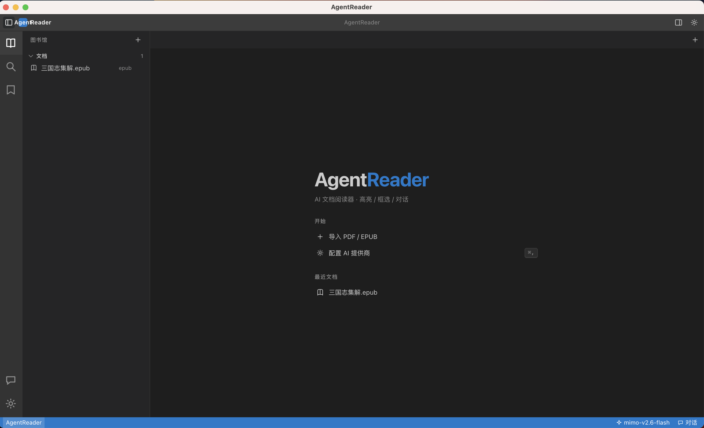
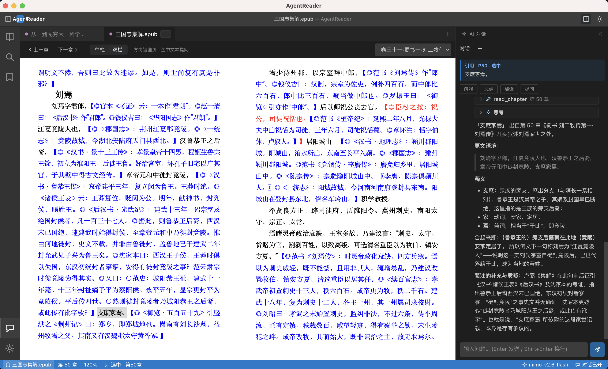

# AgentReader

[English](README.md) | 简体中文

桌面端 AI 文档阅读工具，支持 PDF / EPUB 的导入、阅读、**高亮/矩形框选**与 AI 对话。设计参考 `Reference/pi` —— 麻雀虽小五脏俱全。

## 截图





## 功能

- **图书馆**：导入式管理 `library/{hash}/`，每文档独立文件夹（原文件 + `doc.json` + `annotations.json` + `chats.jsonl`）
- **阅读**：PDF.js `canvas+textLayer`，翻页/缩放/文本选择；EPUB（v0.2）
- **标注**：文本高亮 + 修饰键拖拽矩形框选（macOS `⌥`、其它平台 `Alt`），归一化坐标持久化；EPUB 高亮以 epub.js CFI 锚定，选中后通过菜单选择「高亮标注」
- **AI 对话**：侧边栏，选中自动注入引用，`@` 联想引用章节 / 标注，分级上下文（选中/章节/全文RAG），流式输出
- **多提供商**：复刻 `pi-ai` 的 `Model/Context/StreamFn`，支持 OpenAI 兼容接口

## 技术栈

- Electron + Vite + React + TypeScript
- `packages/ai`：多提供商抽象（OpenAI 兼容）
- `packages/agent`：AgentLoop + `SessionManager` (JSONL)
- `packages/app`：主进程（IPC/图书馆/向量/OCR）+ 渲染进程（PDF/标注/对话）

## 快速开始

```bash
nvm use 22.23.2        # 要求 Node >=22.19.0
npm install           # 需代理/镜像以下载 Electron 二进制
# 代理示例：https_proxy=http://127.0.0.1:7890 npm install
# 镜像示例：ELECTRON_MIRROR="https://npmmirror.com/mirrors/electron/" npm install

npm run dev           # Electron + Vite
# 仅前端（无 Electron）：
npm run dev:web --workspace=@agentreader/app
```

设置 API Key：启动后点击侧边栏 `设置`，填 `Base URL / Model / API Key`。

> macOS 提示：`npm install` / `npm run dev` 会自动执行 `packages/app/scripts/patch-dev-app-name.mjs`，
> 把 `node_modules` 里 Electron.app 的名称补丁为 AgentReader 并 ad-hoc 重签名（macOS 菜单栏/
> Dock 名称取自 .app 包的 CFBundleName，`app.setName` 改不了）。如需还原：重装 electron 即可。

## 打包

在 `packages/app` 下构建 macOS 应用（`.app`）或安装包（`.dmg`）：

```bash
# 仅生成 .app（免签，验证最快）
npm run package:dir --workspace=@agentreader/app   # -> out/mac-arm64/AgentReader.app

# 生成 .dmg 安装包
npm run package --workspace=@agentreader/app       # -> out/AgentReader-<version>-arm64.dmg
```

产物输出到仓库根的 `out/` 目录。当前 macOS 仅支持 **arm64** 且 **未签名**（`packages/app/electron-builder.json` 中 `identity: null`）。首次启动时 macOS Gatekeeper 可能拦截未签名应用 —— 右键 → 打开，或执行：

```bash
xattr -dr com.apple.quarantine /Applications/AgentReader.app
```

Windows 端已预留打包配置（NSIS 安装包，x64，`build/icon.png` 自动转 ico）：

```bash
npm run package --workspace=@agentreader/app -- --win   # -> out/AgentReader-Setup-<version>.exe
```

未签名安装包在 Windows 上会触发 SmartScreen 提示（「更多信息 → 仍要运行」）；正式发布前需补代码签名证书。Windows 的菜单、快捷键提示（Ctrl+…）与单实例行为已适配，但尚未在真机验证。

## 文档

- `docs/requirements.md` 需求文档
- `docs/plan.md` 规划文档
- `docs/plan-v0.2.md` 提供商/多模型/Web Search/Skill 规划
- `docs/progress.md` 进度记录
- `Reference/pi` 参考项目（已 gitignore，不提交）

## 目录

```
AgentReader/
├── docs/
├── packages/
│   ├── ai/         # 多提供商
│   ├── agent/      # AgentLoop + 会话
│   └── app/        # Electron 主/渲染/预加载
└── Reference/      # 参考（忽略）
```

## 路线图

- Phase 1 MVP：PDF + 标注 + 侧边栏对话 + 图书馆
- Phase 2：EPUB + RAG + 多提供商
- Phase 3：OCR 双轨（扫描版）+ 导出 + 扩展系统

## 开源协议

基于 [Apache License 2.0](LICENSE) 授权。
